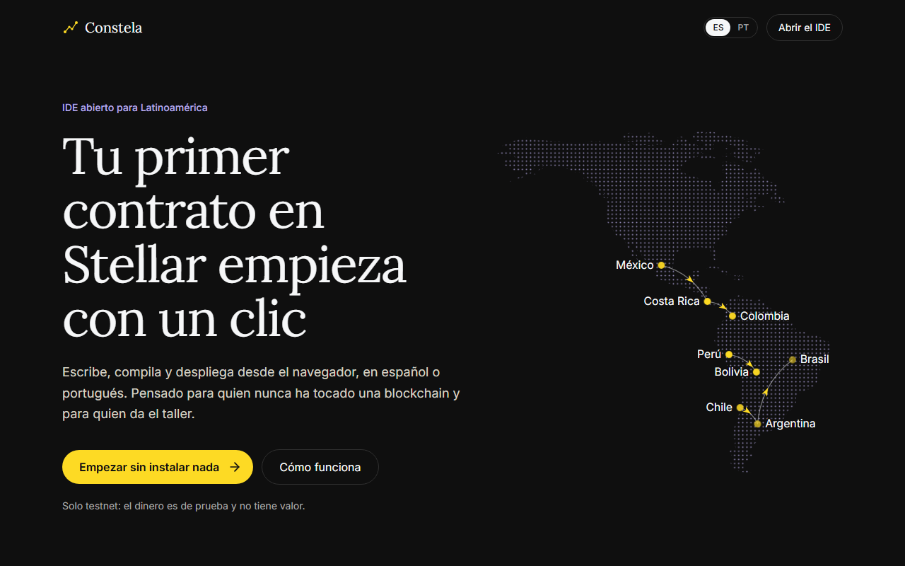
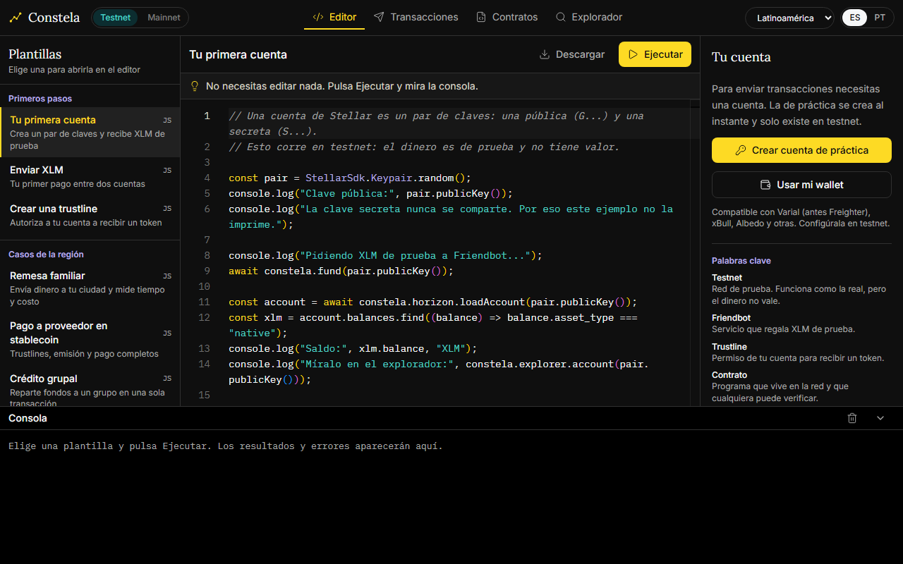

# Constela

*Español · [Português](README.pt-BR.md)*

IDE abierto en el navegador para aprender a construir en Stellar, en español y portugués. Pensado para principiantes y para quienes dan talleres en Latinoamérica.

> Built on Stellar. Este es software independiente, no afiliado, patrocinado ni respaldado por la Stellar Development Foundation.
>
> *Este é um software independente, não afiliado, patrocinado nem endossado pela Stellar Development Foundation.*

**Solo funciona en testnet.** Mainnet está desactivada a propósito: el dinero es de prueba y no tiene valor.





## Qué incluye

- **Sin instalar nada:** cuenta de práctica con XLM de prueba en un clic, sin extensión ni frase secreta.
- **Plantillas adaptadas por país:** remesas, pagos a proveedores, crédito grupal y ahorro rotativo, con ciudad, moneda y nombres locales para Perú, México, Argentina, Colombia, Costa Rica, Bolivia, Chile y Brasil.
- **Consola que explica los errores** en el idioma de cada persona y dice qué hacer.
- **Contratos en Rust:** compila en un contenedor aislado, despliega con un formulario para el constructor y usa cada función con formularios generados desde el contrato.
- **Constructor de transacciones y explorador** para trabajar sin escribir código.

## Estado del proyecto

Versión inicial, en desarrollo. Todavía no hay una instancia pública: por ahora se usa en local.

| Área | Estado |
| --- | --- |
| Cuenta de práctica, plantillas, transacciones y explorador | Probados en testnet |
| Compilar, desplegar y usar contratos | Probados en testnet con el compilador en local |
| Wallets externas | Integradas, pero sin probar con una extensión real |
| Despliegue en producción | Sin probar |
| Nombres locales del ahorro rotativo | Argentina, Costa Rica y Chile usan un término genérico hasta validarlo |
| Mainnet | Desactivada: el código no incluye ninguna URL ni passphrase de mainnet |

`pnpm audit` reporta vulnerabilidades en dependencias, sobre todo las que traen el kit de wallets y Monaco. Están pendientes de revisar antes de abrir una instancia pública.

## Empezar en local

Requisitos: Node.js 22.18 o superior, pnpm 10, y Docker para compilar contratos. Si no tienes pnpm, `corepack enable` activa la versión que usa este proyecto.

```bash
pnpm install
```

```bash
pnpm dev
```

La aplicación queda en `http://localhost:3000`. Las plantillas JavaScript, las transacciones y el explorador funcionan sin nada más.

Para compilar contratos, construye la imagen una vez (tarda varios minutos) y levanta el compilador en otra terminal:

```bash
pnpm compiler:image
```

```bash
pnpm dev:compiler
```

## Estructura

| Carpeta | Contenido |
| --- | --- |
| `web/` | Aplicación Next.js: landing, IDE y traducciones en `web/messages/` |
| `compiler/` | Servicio de compilación e imagen Docker aislada |
| `templates/` | Plantillas JavaScript y contratos con sus pruebas |
| `scripts/` | Generación de plantillas y pruebas de contratos |

## Pruebas

```bash
pnpm test
```

```bash
pnpm test:contracts
```

La segunda corre las pruebas de cada contrato dentro de la imagen de Docker, así que necesita `pnpm compiler:image`.

## Despliegue

Son dos servicios. Esta guía describe lo que pide el código; aún no se ha probado en un servidor real.

### Aplicación web

Corre en cualquier servicio con Node.js que admita Next.js:

```bash
pnpm build
```

```bash
pnpm --filter web start
```

| Variable | Para qué sirve | Valor por defecto |
| --- | --- | --- |
| `NEXT_PUBLIC_COMPILER_URL` | URL pública del compilador | `http://localhost:8787` |
| `NEXT_PUBLIC_SITE_URL` | URL pública de la aplicación, sin barra final. Sin ella, la imagen de vista previa no carga al compartir el enlace. | `http://localhost:3000` |

Ambas se fijan al construir: si cambian, hay que volver a ejecutar `pnpm build`.

### Compilador

Necesita un servidor propio con Docker, porque cada compilación abre un contenedor. Por eso no sirve un hosting sin servidor. En esa máquina:

```bash
pnpm compiler:image
```

```bash
pnpm --filter compiler start
```

| Variable | Para qué sirve | Valor por defecto |
| --- | --- | --- |
| `ALLOWED_ORIGINS` | Orígenes que pueden usarlo, separados por comas. Pon aquí la URL de la web. | `http://localhost:3000` |
| `TRUST_PROXY` | Con `true`, limita por la IP de `X-Forwarded-For`. Actívalo solo detrás de un proxy que escriba esa cabecera. | desactivado |
| `PORT` | Puerto del servicio | `8787` |
| `SANDBOX_IMAGE` | Imagen de Docker que usa | `constela/soroban-sandbox:30.0.1` |
| `MAX_CONCURRENT` | Compilaciones simultáneas | `4` |
| `MAX_QUEUED` | Compilaciones en espera | `20` |
| `RATE_PER_MINUTE` | Compilaciones por minuto para cada IP | `10` |

Antes de abrirlo a Internet:

- Ponlo detrás de un proxy con TLS y usa `GET /health` para vigilarlo.
- Dale a la máquina memoria y CPU para `MAX_CONCURRENT`: cada contenedor puede usar hasta 1 GB y 1 CPU.
- No expongas el socket de Docker. `ALLOWED_ORIGINS` solo frena a los navegadores: una petición sin `Origin` también pasa, y la frenan los límites por IP.

## Modelo de seguridad

- **El código de cada persona corre en un iframe aislado** (`sandbox="allow-scripts"`), con origen opaco y una CSP que solo permite conectarse a Horizon, Soroban RPC y Friendbot de testnet. No puede leer la clave de práctica: para firmar, le pide la firma a la página principal.
- **La cuenta de práctica vive en `localStorage`.** Es cómodo para un taller, pero no es seguro para dinero real, y por eso solo existe en testnet.
- **Cada compilación corre en un contenedor sin red ni volúmenes,** con límites de memoria, CPU y tiempo.

Si encuentras una vulnerabilidad, avisa por un [aviso privado de GitHub](../../security/advisories/new) en lugar de abrir un issue público.

## Cómo contribuir

Las correcciones de idioma y de nombres locales son igual de valiosas que el código. Si algo no suena natural en tu país, abre un issue.

Para proponer un cambio:

1. Abre un issue si el cambio es grande, para conversarlo antes.
2. Crea tu rama y comprueba que `pnpm test` pasa.
3. Si cambias textos, actualízalos en `web/messages/es.json` y `web/messages/pt-BR.json`.
4. Abre un pull request explicando qué cambia y por qué.

No se aceptan cambios que activen mainnet.

### Agregar una plantilla

1. Crea el archivo en `templates/js/` o la carpeta en `templates/contracts/` (`lib.rs` y `test.rs`).
2. Regístrala en `web/src/templates/catalog.ts`, con su texto en `es` y `pt-BR`.
3. Corre `pnpm test`. Las pruebas revisan que no queden tokens `{{...}}` sin reemplazar en ningún idioma ni país.

Los nombres locales del ahorro rotativo están en `web/src/lib/countries.ts`.


## Licencia

[MIT](LICENSE)
