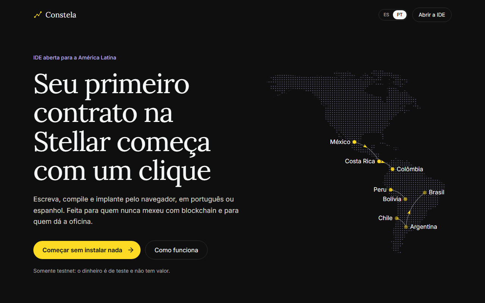
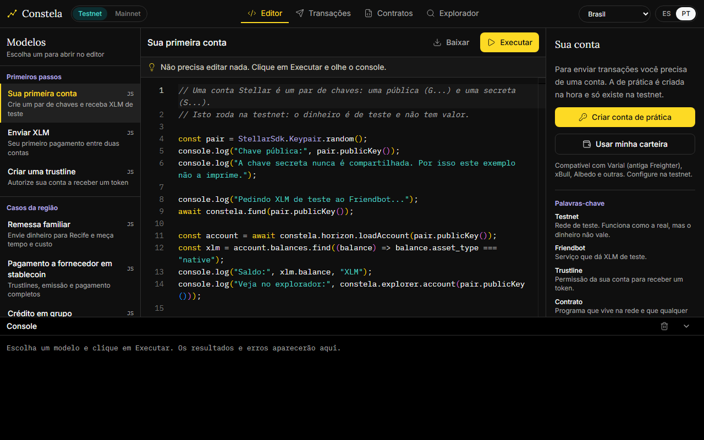

# Constela

*[Español](README.md) · Português*

IDE aberto no navegador para aprender a construir na Stellar, em espanhol e português. Feito para iniciantes e para quem dá workshops na América Latina.

> Built on Stellar. Este é um software independente, não afiliado, patrocinado nem endossado pela Stellar Development Foundation.

**Funciona apenas na testnet.** A mainnet está desativada de propósito: o dinheiro é de teste e não tem valor.





## O que inclui

- **Sem instalar nada:** conta de prática com XLM de teste em um clique, sem extensão nem frase secreta.
- **Modelos adaptados por país:** remessas, pagamentos a fornecedores, crédito em grupo e poupança rotativa, com cidade, moeda e nomes locais para Peru, México, Argentina, Colômbia, Costa Rica, Bolívia, Chile e Brasil.
- **Console que explica os erros** no idioma de cada pessoa e diz o que fazer.
- **Contratos em Rust:** compila em um contêiner isolado, implanta com um formulário para o construtor e usa cada função com formulários gerados a partir do contrato.
- **Construtor de transações e explorador** para trabalhar sem escrever código.

## Estado do projeto

Versão inicial, em desenvolvimento. Ainda não há uma instância pública: por enquanto é usado localmente.

| Área | Estado |
| --- | --- |
| Conta de prática, modelos, transações e explorador | Testados na testnet |
| Compilar, implantar e usar contratos | Testados na testnet com o compilador local |
| Carteiras externas | Integradas, mas sem teste com uma extensão real |
| Implantação em produção | Sem teste |
| Nomes locais da poupança rotativa | Argentina, Costa Rica e Chile usam um termo genérico até a validação |
| Mainnet | Desativada: o código não inclui nenhuma URL nem passphrase da mainnet |

O `pnpm audit` aponta vulnerabilidades em dependências, principalmente as que vêm com o kit de carteiras e o Monaco. Elas precisam ser revisadas antes de abrir uma instância pública.

## Começar localmente

Requisitos: Node.js 22.18 ou superior, pnpm 10, e Docker para compilar contratos. Se você não tem pnpm, `corepack enable` ativa a versão usada neste projeto.

```bash
pnpm install
```

```bash
pnpm dev
```

A aplicação fica em `http://localhost:3000`. Os modelos JavaScript, as transações e o explorador funcionam sem mais nada.

Para compilar contratos, construa a imagem uma vez (leva vários minutos) e inicie o compilador em outro terminal:

```bash
pnpm compiler:image
```

```bash
pnpm dev:compiler
```

## Testes

```bash
pnpm test
```

```bash
pnpm test:contracts
```

O segundo roda os testes de cada contrato dentro da imagem Docker, então precisa de `pnpm compiler:image`.

## Mais detalhes

A estrutura do repositório, o guia de implantação com todas as variáveis e o modelo de segurança estão no [README em espanhol](README.md).

## Como contribuir

Correções de idioma e de nomes locais valem tanto quanto código. Se algo não soa natural no seu país, abra uma issue.

Para propor uma mudança:

1. Abra uma issue se a mudança for grande, para conversar antes.
2. Crie sua branch e confira se `pnpm test` passa.
3. Se mudar textos, atualize `web/messages/es.json` e `web/messages/pt-BR.json`.
4. Abra um pull request explicando o que muda e por quê.

Mudanças que ativem a mainnet não são aceitas.

Para informar uma vulnerabilidade, use um [aviso privado do GitHub](../../security/advisories/new) em vez de uma issue pública.

## Licença

[MIT](LICENSE)
